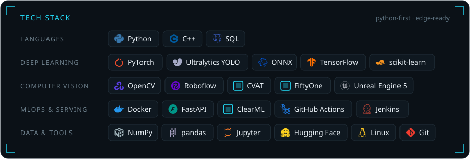
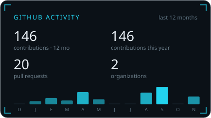
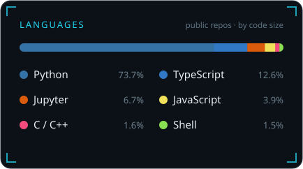
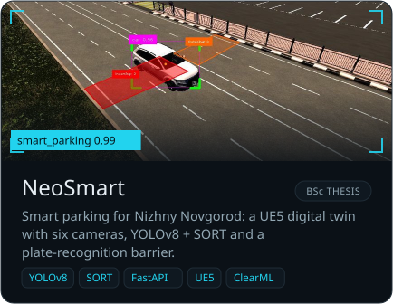
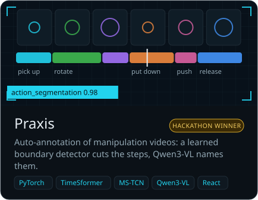
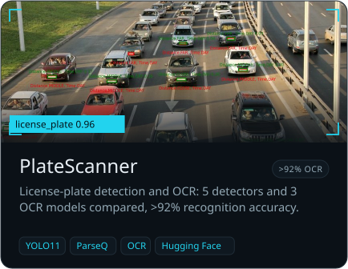
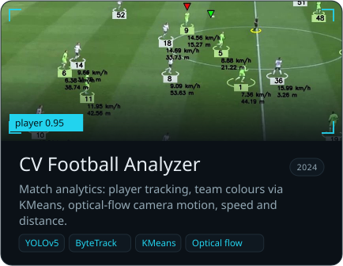

<picture>
  <source media="(max-width: 600px)" srcset="assets/banner-mobile.svg">
  
</picture>

  
  
   
  
  

  

  

   

## Featured work

   
   
   

## Contributions

<picture>
  <source media="(prefers-color-scheme: dark)" srcset="https://raw.githubusercontent.com/PavelLekomtsev/PavelLekomtsev/output/snake-dark.svg">
  
</picture>

  
  
  

